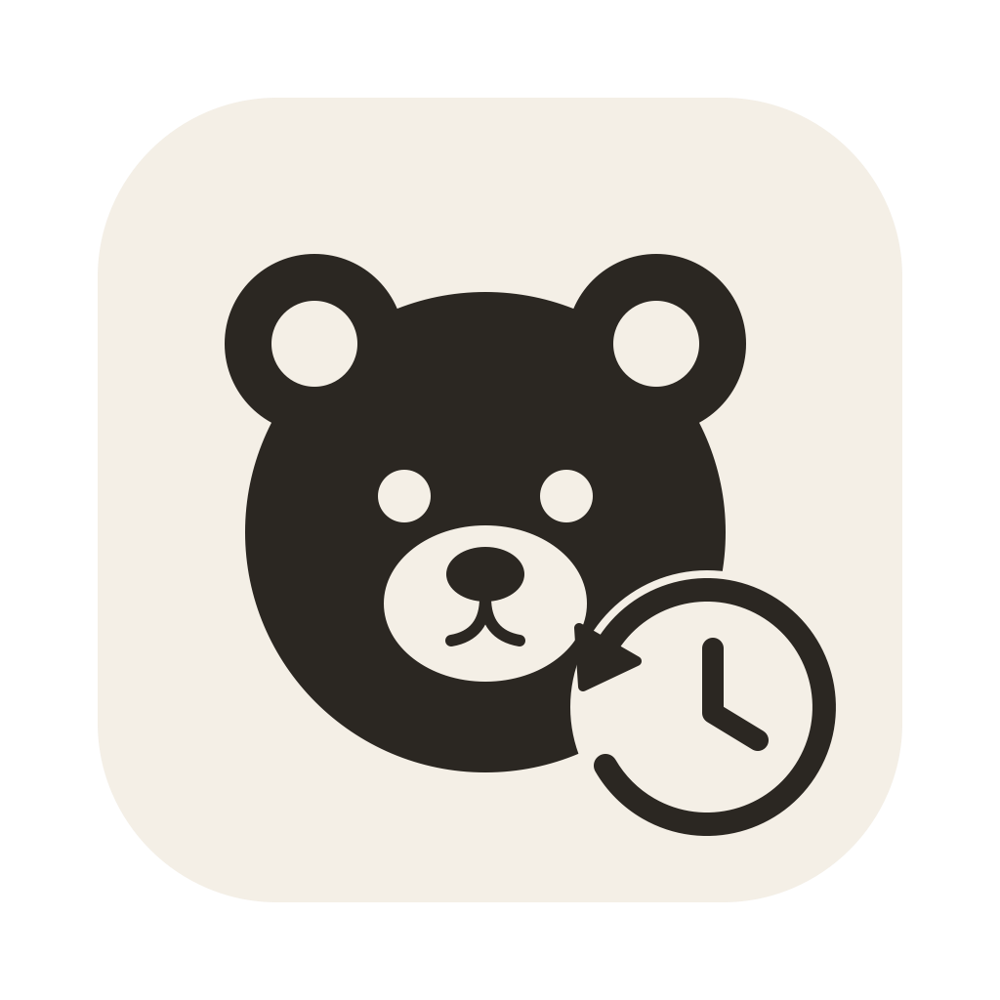
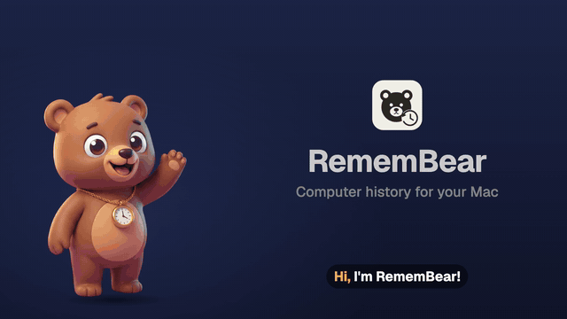
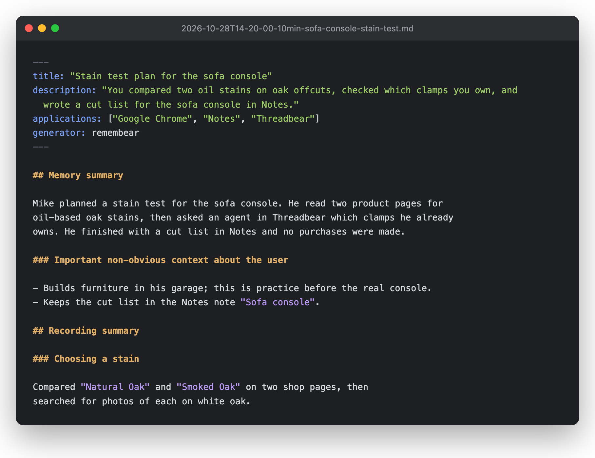
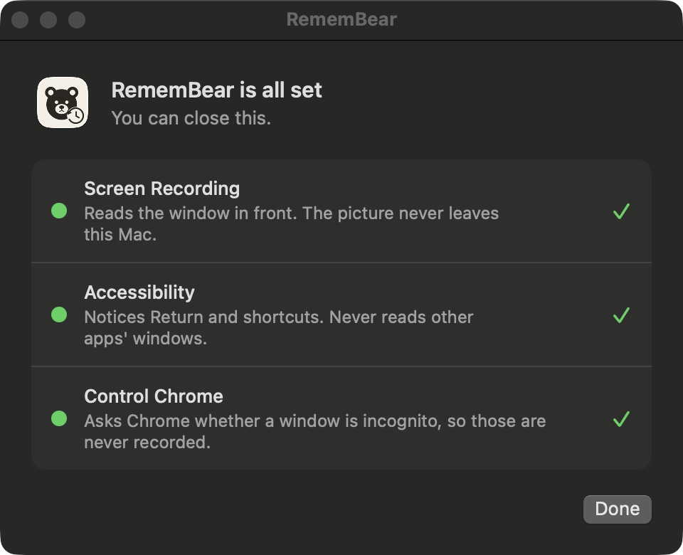

#  RememBear

A computer history for your Mac that you own: it remembers what you were doing, so your AI agents can too

macOS 14 or later

<!-- media: hero -->
<a href="docs/media/remembear.mp4"></a>

<sub>25 s. Click for the video with sound.</sub>
<!-- /media: hero -->

## What it is

My own version of ChatGPT's Computer History, which I've turned off. It's a little menu bar app that keeps track of what I'm doing on my Mac, and every 10 minutes it asks Claude (on my own subscription) to write a short summary. Every 6 hours it writes a longer one covering the whole stretch. The summaries are Markdown files in the same format Codex used, so [Agent Archive](https://agent-archive.mikecann.app) backs them up and my agents can search them ("what was I doing on Tuesday afternoon?").

This is what one of the 10-minute summaries looks like (a made-up one, mine are a lot more boring):



It's one of the bears that plug into Threadbear, the app I run my agents in, with [BrowserBear](https://github.com/mikecann/browserbear) and [ComputerCub](https://github.com/mikecann/computercub). It was called Recall It until 30 Oct 2026.


## Get it

Paste this into your AI coding agent (Claude Code, Codex, Cursor...):

> Fork https://github.com/mikecann/remembear to my GitHub account and clone my fork
> (if I don't use GitHub, or want to keep my copy private, just clone it instead),
> then make it my own. It's one of Mike Cann's personal tools, so read the README
> first, change anything specific to his setup to suit mine, then help me get it
> running.

The main thing to change is in `Sources/RememBearCore/Prompts.swift`: the summary prompt is written about me, by name.

### Or set it up by hand

You'll need macOS 14 or later, Xcode or the Command Line Tools with Swift 6 or later, and [Claude Code](https://claude.com/claude-code) signed in, as that's what writes the summaries. Screen search also wants [uv](https://docs.astral.sh/uv/); without it everything else still works.

```bash
git clone https://github.com/mikecann/remembear.git
cd remembear
bash restart.sh
```

That builds and opens `~/Applications/RememBear.app`, and the first time a setup window walks you through the permissions it needs:



Each row starts red, has a button that opens the right part of System Settings, and goes green once it's on. It's under Permissions… in the menu later, or open RememBear.app again.

## What it records

While I'm at the Mac:

- the app and window in front, its title and (in Chrome and other Chromium browsers) the URL
- the words in that window when it changes, once a minute after that if they change, and just after I press Return. The words come from a screenshot of that one window, read by macOS's own text recognition on the Mac. The screenshot is never saved or sent anywhere: it's dropped as soon as it's read
- that I pressed Return (a sent message, a search), and keyboard shortcuts like ⌘T

It records no audio and doesn't log keystrokes. It stops when I'm away for 5 minutes or the screen is locked.

Until 30 Oct 2026 it read windows through the Accessibility API instead, and asked what was under every click. That made every app it read do the work itself: Threadbear took half a second to switch views, and Chrome and Electron apps had to keep their accessibility trees built. A screenshot comes from the window server and costs the app nothing.

## Searching what was on screen

Each capture that gets recorded is also turned into a vector by [EmbeddingGemma 2](https://huggingface.co/google/embeddinggemma-2), Google's open multimodal embedding model, running on this Mac's GPU. So a question in words finds the moments that looked like it, pictures and charts included, not just the summaries' text:

```bash
remembear search "the convex usage chart" [--limit 10] [--days 7] [--json]
```

- The screenshot goes to the embedder in memory, over 127.0.0.1 with a token, and is never written down. The model runs here, so nothing leaves the Mac.
- Only captures that passed every privacy check above get a vector, so search never holds anything the events wouldn't.
- `search.sqlite` keeps the vector, the time, app, window title, URL and the first 400 characters of the masked text, for 30 days. Forget the Last Hour clears it too.
- The embedder (`embedder/server.py`) starts when there's something to embed, takes about 7 s to load and holds about 3 GB while loaded, so it quits after 10 idle minutes. `restart.sh` sets up its Python packages with `uv`; the model (about 1.5 GB) downloads from Hugging Face the first time.

## What it never records

- **Private browser windows.** The window list only has a page's title, and an incognito window's title doesn't say it's incognito, so RememBear asks Chrome (and other Chromium browsers) over AppleScript whether the front window is normal or incognito, and records nothing unless it's normal. Safari and Firefox can't say, so nothing from them is recorded at all.
- **Password managers** (1Password, Passwords, Keychain Access, Bitwarden, KeePassXC, Proton Pass and friends) and their web vaults (1password.com, Bitwarden, LastPass, Dashlane, Proton Pass), macOS's own password and Touch ID prompts, and the lock screen.
- **Terminals** (Terminal, iTerm2, Ghostty, Warp, WezTerm, Alacritty, kitty, Hyper, Tabby). They show env dumps and keys in all sorts of shapes, and masking can't be sure it's caught them all.
- **Secrets on screen.** A screenshot sees everything, so the text is masked before it's written: every environment variable's value (`FOO_BAR=…`, `FOO_BAR: …`, a dashboard's name and value), anything labelled as a password, token or key, passwords in URLs, auth headers, Convex deploy keys, private keys, long base64 lines, and anything shaped like an API key, token or card number.
- **Pages that make or show keys.** Any page whose address looks like it's for API keys, tokens, credentials, secrets or environment variables (OpenAI's /api-keys, GitHub's /settings/tokens, a Convex dashboard's settings and so on), and any screen whose text reads like a new key being shown ("copy it now, you won't be able to see it again"), is skipped whole, as a new key can be any shape. That covers an agent making a key for me with BrowserBear or ComputerCub too.
- **Apps and sites I've excluded** from the menu ("Don't Record Slack", "Don't Record bank.com"). Excluding a site covers its subdomains.

Those checks happen before a window is captured, and again after, so excluded stuff never reaches the disk.

## Where things go

- `~/Library/Application Support/RememBear/events/`: raw events, one file per 10 minutes, **deleted after 48 hours**.
- `~/Library/Application Support/RememBear/summaries/`: the summaries, kept. Agent Archive reads this folder.
- `~/Library/Logs/remembear.log`: what it did and when, with no activity content.

Both folders are owner-only. The only thing that leaves the Mac is the 10-minute digest sent to Claude to be summarised, and the summaries Agent Archive backs up.

## Menu

Pause for an hour or until tomorrow, stop recording the app in front (or the site it's on), forget the last hour (which deletes events and summaries here, and Agent Archive mirrors recent deletes), open the summaries folder, and Open at Login.

## Settings

There's no settings window. Use `defaults write app.mikecann.remembear <key> <value>`:

| Key | Default | |
|---|---|---|
| `tenMinuteModel` | `haiku` | model for the 10-minute summaries |
| `sixHourModel` | `sonnet` | model for the 6-hour ones |
| `claudePath` | `~/.local/bin/claude` | |
| `claudeConfigDir` | unset (`~/.claude`) | which Claude login to use |
| `excludedApps`, `excludedSites` | empty | also editable from the menu |

## Your agents

Any agent that can read files can read the summaries folder. I use [Agent Archive](https://agent-archive.mikecann.app), which backs them up and gives every agent a search tool for them:

```bash
agent-archive configure-computer-history --dir "$HOME/Library/Application Support/RememBear/summaries"
```

`restart.sh` also links `remembear` into `~/.local/bin`, so an agent can run `remembear search` from its shell.

## Uninstall

`bash uninstall.sh` removes the app. Add `--delete-data` to delete the events and summaries too.

## Development

```bash
swift build
swift test
bash restart.sh     # build, sign and relaunch the app
```

It signs with your first Apple Development identity if you have one, so the permissions stick around when you rebuild. Without one it signs ad hoc and macOS asks again after every build. `AGENTS.md` has more for agents working on it, privacy checks first.

## Art

`docs/header.webp` is a generated banner for the public site, and `docs/media/remembear.mp4` is the explainer, made with Remotion. `icons/remembear.svg` is the app icon, BrowserBear's cub with a clock running backwards, and `icons/remembear.png` is rendered from it.

## More tools

You can find my other tools at [mikerosoft.app](https://mikerosoft.app).

MIT licensed.
